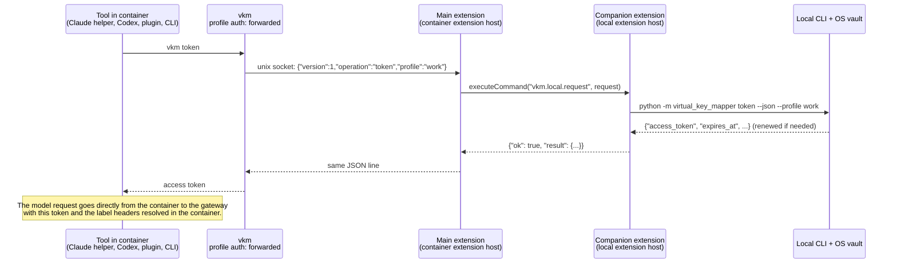
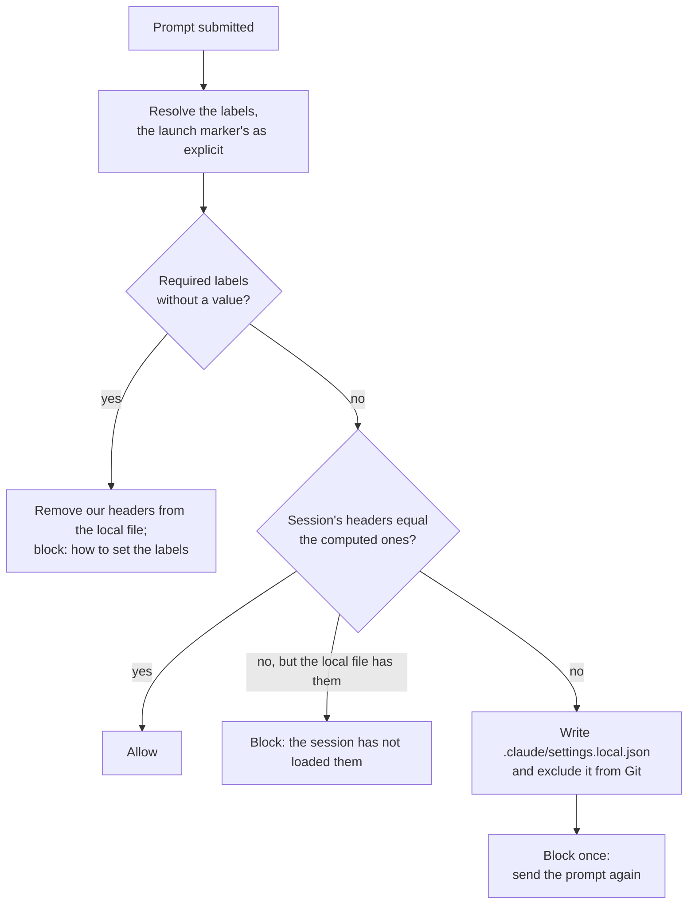

# Architecture

How `vkm` and its two VS Code extensions work, and why they are built this way.
Read the [README](../README.md) first for what the tool does; this document is for people
changing or reviewing it.

## 1. The problem and the goals

Developers use several AI coding tools against one company LLM gateway. Spend must be
attributed by the labels of the repository it is for (the customer, a project, whatever the
organisation needs), and the gateway's single sign-on
must be used instead of long-lived API keys. In priority order:

1. As little developer interaction as possible to give each repository its labels.
2. It just works for Claude Code (CLI and VS Code), Codex, OpenCode and Copilot Chat,
   locally and in Dev Containers.
3. Short-lived, renewing SSO credentials; no `sk-` keys to issue, rotate or paste.
4. Gateway, sign-in method and tools stay replaceable without over-engineering.

Non-goals: enforcing which label values someone may use (that belongs on the gateway), and
attributing traffic the tools send to their vendors directly (Copilot inline completions).

## 2. Overview

```text
                ┌───────────────────────────── vkm (Python) ─────────────────────────────┐
 input side     │  auth adapters        litellm-sso (browser SSO, renewal)   forwarded (relay)        │
                │  gateway adapters     litellm (endpoints, outputs tags + metadata, tag catalogue)  │
 core           │  profiles · OS vault · labels, resolver, formats · CLI JSON contracts              │
 output side    │  integrations         claude · codex · opencode  (setup, run)                       │
                └──────────────────────────────────────────┬─────────────────────────────────────────┘
                                                           │ token --json · repo show --json · profile show --json
                                   ┌───────────────────────┴───────────────────────┐
                                   │  VS Code extension (Copilot Chat models,       │
                                   │  relay in remote windows)                      │
                                   │  companion "local sign-in" (local machine)     │
                                   └────────────────────────────────────────────────┘
```

Every tool ends up doing the same two things per request: get a short-lived credential by
calling the CLI (directly or through its own credential hook), and send the gateway's
attribution headers for the directory it works in. The CLI is the single source of truth
for both; the tools and extensions only consume its outputs.

### Source layout

| Path | Role |
| --- | --- |
| `src/virtual_key_mapper/adapters.py` | Interfaces: `Auth`, `Gateway`, `Integration`, `Credential`, `Api` |
| `registry.py` | The three adapter tables, profile validation, `auth_for`, `gateway_for` |
| `profiles.py` | Profiles (`profiles.json`), file locks, atomic writes, rules location validation |
| `storage.py` | OS vault (`keyring`), split into fragments for Windows' size limit |
| `labels.py` | Label definitions, outputs and format strings, the effective `LabelConfig`, headers, the launch marker |
| `rules.py` | The central rules document (version 2), its matching and cache |
| `resolve.py` | Per-key resolution, `.vkm` files, loading the configuration, the `repo show --json` document |
| `repositories.py` | Git identity normalization, `find_checkout`, personal label bindings (`repositories.json`) |
| `auth/litellm_oauth.py`, `auth/litellm_sso.py` | LiteLLM native SSO client; session renewal and locking |
| `auth/forwarded.py` | Credentials relayed from the local machine (Dev Containers) |
| `gateways/litellm.py` | LiteLLM endpoints, the `tags` and `metadata` outputs, the `/tag/list` catalogue |
| `integrations/claude.py`, `codex.py`, `opencode.py` | Tool setup, launch and (Claude) the prompt guard |
| `shells.py` | Per-directory shell hooks for environment-driven tools (Codex) |
| `service.py` | One profile's operations as data (sign-in, labels, repositories), shared by the commands and the local server |
| `server.py` | `vkm serve` and `vkm ui`: the JSON documents over HTTP on 127.0.0.1, with a token per start |
| `proxy.py` | `vkm serve --proxy`: forwards model requests to the gateway's endpoint per API, with the key and the labels |
| `ui/` | The setup page `vkm ui` opens: plain HTML, CSS and JavaScript, no build step; it only calls the server's API |
| `cli.py` | Commands: arguments, the terminal picker and printing; reaches adapters only through the registry |
| `vscode-extension/` | Copilot Chat model provider and the remote relay (TypeScript) |
| `vscode-extension/local/` | Companion extension that runs on the local machine |

`tests/test_architecture.py` enforces the layering: the core and the integrations may not
import `auth/` or `gateways/` modules, and may not contain vendor header names or URL
paths. Only `registry.py` wires adapters in.

## 3. Adapters: why the core knows no vendor

Three adapter kinds, each a small protocol in `adapters.py` with one table in `registry.py`:

- **Auth** obtains a `Credential` (secret, optional expiry, user, optional notice):
  `login`, `logout`, `status`, `credential`. Kinds: `litellm-sso`, `forwarded`.
- **Gateway** knows endpoints per wire API (`anthropic-messages`, `openai-chat`,
  `openai-responses`), which outputs (request headers) it can fill with labels, and an
  optional catalogue of label values. Kind: `litellm`.
- **Integration** configures and launches one tool: `setup`, `remove`, `command`, `launch`.
  Kinds: `claude`, `codex`, `opencode`.

A profile names one gateway kind and one auth kind, plus the auth kind's settings and, optionally,
its central rules location and its own label definitions and output overrides
(`profiles.json`):

```json
{"version": 1, "active": "work", "profiles": {"work": {
  "gateway": {"type": "litellm", "url": "https://gateway.example", "allow_http": false},
  "auth": {"type": "litellm-sso", "team_id": "TEAM"},
  "rules": "https://gateway.example/label-rules.json",
  "labels": [{"key": "project", "description": "Project within the customer"}],
  "outputs": {"metadata": {"enabled": false}}}}}
```

Why two input-side axes: sign-in methods and gateways combine freely in practice (a fixed
key works with any gateway; LiteLLM SSO only with LiteLLM). An auth kind can restrict the
gateway kinds it accepts (`litellm-sso` → `litellm`). Adding a gateway, auth kind or tool is
one module plus one registry line ([adapters.md](adapters.md)).

Why no plugin system: adapters are code in this repository, reviewed with it. Entry points,
dynamic loading or config-defined adapters would add surface without a current need.

Tools and extensions never see header names or URL paths. They read three JSON contracts:

| Command | Output |
| --- | --- |
| `token --json` | `{"access_token", "expires_at" (number or null), "profile", "user"}` |
| `repo show --json --directory D [--launch]` | `{"labels": [{"key", "value", "name", "source", "detail", "required", "description"}], "missing", "ignored", "repository", "complete", "headers": {...}, "message", "notices"}`; exit 0 also while labels are missing (`headers` is then empty) or cannot be resolved (`complete: false`, the error as `message`); exit 1 only when the configuration cannot be loaded |
| `profile show [NAME] --json` | `{"name", "gateway": {"type", "url"}, "auth": {...}, "rules", "endpoints": {api: url}}` plus the profile's own `labels` and `outputs` |

`vkm serve` returns the same documents over HTTP (`/api/token`, `/api/repository`, `/api/profiles`
with `{"default", "profiles": [...]}`, and the `--json` outputs of `status`, `labels list`, `labels values`
and `models list`), wrapped as `{"result", "messages"}`. Changes are `POST` requests with a JSON object body
that call the same service operations as the commands (profile add and use, login, logout, setup, bind, unbind). The same rule holds: add fields, never rename or
remove one without updating every consumer.

## 4. Signing in: LiteLLM native SSO

### Login

LiteLLM publishes a versioned native-client contract at `/.well-known/litellm-cli-auth`.
`login` (in `auth/litellm_oauth.py`):

1. Reads the discovery document; requires contract version 1, PKCE S256, authorization
   code and refresh grants, public clients and revocation. Every endpoint must be on the
   configured gateway origin (scheme, host and port), without credentials, query or fragment.
2. Registers a public client for a loopback redirect `http://127.0.0.1:<ephemeral>/callback`.
3. Opens the browser to the authorization endpoint (or prints the URL with `--no-browser`).
   The user signs in with the company IdP and chooses the team at consent.
4. Receives the code on the loopback listener (state compared in constant time, Host header
   checked), exchanges it with the PKCE verifier.
5. Accepts the grant only if the returned team ID equals the profile's team ID; otherwise
   the new grant is revoked immediately.
6. Saves the session under the profile's lock, then revokes the previous refresh grant.

The browser step runs without holding the profile lock (other tools keep working); an
interruption at any point before the session is saved revokes the new grant, so no unsaved
grant stays alive. Requests to the gateway never follow redirects and error bodies are never
shown.

### The stored session and the vault

The session (access token, rotating refresh token, issue and expiry time, the endpoints
used for refresh and revocation, renewal state) is one JSON object in the OS vault, under an
account derived from the configuration folder and the profile's identity:
`sha256([config folder, sha256([name, gateway type, gateway, auth type, auth settings])])`.
Including the folder means two configuration folders never share a grant; they also never
share a lock (locks live in the folder), which would otherwise allow two processes to rotate
one refresh token concurrently.

Windows Credential Manager limits entries to 2,560 bytes, so larger sessions are split into
fragments; a small manifest pointing at a complete, hashed generation is written last, so a
crash never leaves a half-written session readable. macOS Keychain replaces an entry by deleting it and
adding the new one; if the add fails, the previous entry is written back. There is no plaintext fallback: without
a supported vault the command fails (containers use the relay instead, section 6).

### Renewal

`token` (and every tool through it) calls `SessionManager.session()`:

- Renewal starts early, when less than `min(max(10 min, lifetime/4), lifetime/2)` remains;
  for LiteLLM's default 24-hour tokens that is 6 hours before expiry. A failed attempt
  therefore still leaves a long-valid token.
- Renewals are serialized per profile with a cross-process file lock (60 s wait); a waiting
  process re-reads the vault and uses the sibling's rotation.
- Temporary failures (no response, 408, 429, 5xx, redirects, unreadable responses) keep the
  refresh token and set a retry time: 30 s, doubling to 15 minutes, never later than one
  attempt before the token becomes unusable. Concurrent callers therefore share one failed
  attempt instead of each blocking on the network.
- Other client errors (e.g. `invalid_target` after a base-URL change, or an ingress 403/404)
  are retried the same way and reported as a gateway configuration problem, with the
  gateway's OAuth `error` and sanitized `error_description`.
- A refused refresh grant (`invalid_grant` or `invalid_client`) stops renewal but keeps
  releasing the current access token until 60 s before expiry; `status` reports `re-login-required` and the CLI prints a warning
  on stderr. A renewal that changes user or team blocks the session at once.
- A token with 60 s or less left is never handed out; validity is measured after any slow
  network attempt.

Why this policy (from LiteLLM's source): the gateway claims a refresh token only after
minting its replacement, outages answer 503 and leave the token valid, and a replayed
refresh token gets 400 without revoking the grant. Retrying is therefore safe, and a refused
renewal is not a reason to throw away an access token that is still valid (LiteLLM access
tokens cannot be revoked anyway).

## 5. Labels

The user-facing reference is [labels.md](labels.md); this section explains the implementation
and the reasons.

### Definitions and configuration

`labels.py` holds the label model and imports nothing but `errors`. A `LabelConfig` combines
three pieces, checked together every time the configuration is loaded
(`resolve.load_config`):

1. the central rules document's `labels` and its `outputs` section for the profile's gateway type;
2. the profile's own `labels` and `outputs` (personal additions);
3. the gateway adapter's declared outputs and their defaults (section 3).

Central labels come first in document order, then the profile's in the order they were added.
A profile label whose key (or `VKM_LABEL_` variable name) the central document defines, and a
profile override of an output the document overrides, are dropped and reported as notices; the
central piece applies; a profile override that uses the key of such a dropped label is dropped
with it (the adapter default applies), so it cannot block every request. `profile add/update`
refuses such a label outright when the document can be read; when it cannot, the profile is still
checked on its own, treating placeholders it does not define as possible central required labels. Problems that would let a request out with wrong or missing attribution make the whole
configuration invalid, which blocks every request with one message: an output the gateway does not
have, a format error, a central format using a profile label, or a required label that reaches no
output. A required label reaches an output only through an enabled `list` entry whose other
placeholders are all required; an enabled `json` output counts only when no `list` output is
enabled.

Why objects in a list and not a map keyed by label: order matters (status bar, tag order, picker)
and survives any JSON tool, and new fields fit without changing the shape. Why unknown fields are
refused in a known document version: a typo like `"requried"` must not silently make a required
label optional.

### Resolution

`resolve.resolve_labels(directory)` is used by every integration and both extensions (through
`repo show`). Each defined key is resolved on its own; the first source the definition allows
(`sources`) with an entry wins:

1. `explicit`: `--label KEY=VALUE` of `run` or `repo show` (also the launch marker, below);
2. `env`: `VKM_LABEL_<KEY>`, exactly that name (empty counts as unset; an invalid value is an
   error naming it; any other `VKM_LABEL_*` variable is ignored as unknown under its own name);
3. `local`: the personal binding in `repositories.json` (version 2) for the checkout's `origin`,
   then `upstream`, per key;
4. `file`: the nearest `.vkm` file, searching upward and stopping below the home directory; the
   nearest file wins as a whole;
5. `rules`: the profile's central rules, each rule tried against `origin`, then `upstream`; each
   key from the first matching rule that sets it.

An empty value (`--label KEY=`, `""` in `.vkm`, `null` in a rule) is an entry with no value: the
search for that key stops there. The result (`Attribution`) carries each label's value, source
and detail, the required keys without a value, values that were ignored (unknown key, or a source
the definition does not allow) and the repository. While a required key is missing, no headers
can be built: every tool is blocked with a message starting with the fixed phrase
`Required labels have no value:`, which the Claude guard, the OpenCode plugin and the VS Code
extension recognise. With no labels defined at all, requests carry only the repository metadata.

`vkm run --label` passes its values to the child in `VKM_LAUNCH_LABELS` (compact JSON of the
`--label` values only). The resolver never reads it: only the Claude guard and the OpenCode
plugin (through `repo show --launch`) treat it as explicit, so a session started with `run --label`
keeps its labels without the marker becoming a way to set labels for everything. A malformed
marker counts as absent.

Repository identity (`repositories.repository_identity`) normalizes Git remotes so HTTPS and
SSH forms of one repository match: credentials, ports and `.git` removed, host and path
lowercased for every forge, Azure DevOps HTTPS/SSH/`visualstudio.com` forms collapsed to
`dev.azure.com/org/project/repo`, SSH host aliases resolved with `ssh -G` (plain host names
only, so no option injection), forge SSH-over-443 endpoints (`ssh.github.com`,
`altssh.gitlab.com`, `altssh.bitbucket.org`) mapped back to the forge host, and the `scm/`
prefix of Bitbucket Server HTTPS remotes (`host/scm/project/repo`, three segments, not on
github.com, gitlab.com, bitbucket.org or dev.azure.com) removed. No Git remote is contacted.
A forge served under a sub-path (GitLab with a relative URL root such as
`https://host/gitlab/group/repo`, SSH `host:group/repo`) cannot be recognized from the remote,
so its two forms stay different identities: rules need one entry per form.

Why this order: explicit beats implicit; a personal binding must be able to correct a wrong
team-wide setting; a committed file is a deliberate, reviewable team decision; central rules
cover whole organizations without per-repository work. Why per key: one label often comes from
the organisation (`customer` by rule) and another from the team (`project` in `.vkm`). Why the
nearest `.vkm` wins as a whole: a file is one reviewed decision, and mixing in a parent's keys
would attribute to a combination nobody wrote. Why the search stops at home: folders above it
(`C:\Users`, `/home`) are shared, and a file planted there must not label everyone's projects.
Why rule order decides between `origin` and `upstream`: administrators list specific rules
before catch-alls, so a fork of `acme-web` should get acme's rule even if a later catch-all
matches the fork's own address. Why `repo bind --label` refuses to change a bound value without
`--replace`: a session that bound it concurrently must not be overwritten silently.

### Central rules

`rules` in a profile is an HTTPS URL (HTTP only for opted-in loopback) or an absolute file
path. The document has a `"MAJOR.MINOR"` version (`"2.0"`): an unknown major is refused; a newer
minor of a known major is accepted with its unknown fields ignored (and `repo show` says so). It
must be valid on its own: rules and central formats may use only central labels, rule values
must be valid (and listed for a `strict` label; a rule for a label whose `sources` exclude
`rules` is allowed and ignored at resolution), at most 1000 rules with at most 8 `**` per
pattern, compiled once and matched in linear time (no regular-expression backtracking). URLs are cached in `<config folder>/rules-cache/` for an hour and
revalidated with the ETag; on a failed fetch, or when a newly published document is invalid
(also in combination with the profile and the adapter), the last good cached copy is used, so a
rules outage or a broken edit does not block work; without one it is an error. Patterns match the
identity `repo show` prints, which is percent-decoded: `dev.azure.com/org/My Project/**`, not
`My%20Project`. The gateway credential is sent only if the rules URL is on the gateway's own
origin.

The picker's choices for a label are its `values`, else the gateway's catalogue, else any valid
typed value (`vkm labels values KEY` says which). The credential is requested only when a
catalogue can apply, so without one no sign-in is needed. The LiteLLM catalogue exists only when the tags
output has an entry `PREFIX${KEY}SUFFIX` with one placeholder (the default `KEY:${KEY}`
qualifies): `/tag/list` names with that prefix and suffix, stripped. Publish `values` in the
central document: LiteLLM's `/tag/list` scopes non-admins to spend of keys stored in its
database, which SSO session tokens never are, so it is usually empty for developers (see
[Gateway requirements](#11-gateway-requirements)). Rows it does return are spend tags; LiteLLM's
automatic `<Header>: <value>` tags (`User-Agent: ...`) and invalid names are dropped.

### Attribution headers

A gateway adapter declares its outputs; the core fills them. The LiteLLM adapter has two:

| Output | Kind | Header | Default |
| --- | --- | --- | --- |
| `tags` | `list` | `x-litellm-tags` | one `KEY:${KEY}` entry per label, in order |
| `metadata` | `json` | `x-litellm-spend-logs-metadata` | on |

```text
x-litellm-tags: customer:acme,project:webshop
x-litellm-spend-logs-metadata: {"labels":{"customer":"acme","project":"webshop"},"repository":"github.com/acme-shop/web","sources":{"customer":"rules","project":"file"}}
```

The central document (per gateway type, wins) or the profile may override a `list` output's
format or switch an output off. A format is compiled once into literal text and `${KEY}`
placeholders (`$$` is a literal `$`, anything else with `$` is an error) and substituted in one
left-to-right pass, so a value is never read as a format. An entry using an optional label
without a value is dropped; a list with no entries left omits its header. Results must be valid
tags (printable ASCII without `,`, not starting with `!` or `&`, at most 512 characters, not
LiteLLM's `User-Agent: ` or `default` tags) and every header at most 4096 bytes; otherwise
nothing is sent. Look-alikes are refused: two placeholders may not be adjacent; if an entry
starts with a placeholder, all entries must start with the same one; and entries that start with
literal text whose texts before the first placeholder are equal, or one a prefix of the other,
must have the same first placeholder. With `${customer}` next to `${project}`, or
`customer:${customer}` next to `customer:${project}`, a project value could produce a tag that
reads as a customer.

The metadata is sent even when no label has a value. LiteLLM stores it with each spend-log entry,
so spend can be re-attributed later if a mapping was wrong. Why tags and not LiteLLM Projects:
SSO session credentials carry no project and Projects require per-project virtual keys
([future/litellm-projects.md](future/litellm-projects.md)). Header names are fixed by the adapter; a format never
chooses a header.

## 6. Dev Containers: the relay

### Why forward instead of storing credentials in the container

A container has no OS vault. Storing the session in a file there would put a refresh token
(valid 14 days and renewing itself) where the AI agents run with shell access, and every
container would need its own browser sign-in, again after every rebuild. Instead the
container asks the local machine for a short-lived access token whenever it needs one; the
refresh grant never leaves the local vault.

Alternatives considered:

| Option | Why not |
| --- | --- |
| File store in the container | Refresh token readable by agents and dependencies; sign-in per container |
| A local daemon reachable over TCP (`host.docker.internal`) | A service to install and keep running, a network port, a shared secret to distribute, Docker-Desktop-specific |
| Forwarding an SSH-agent-style socket | Needs per-container `devcontainer.json` mounts and a daemon on the host |
| VS Code's built-in port forwarding | Forwards container ports to the host, not the other way round |

VS Code already maintains an authenticated channel between the local window and the remote
extension host. Commands registered by an extension in one extension host can be executed
from the other. The relay uses exactly that, so it needs no service, no port and no
per-project configuration.

### Why two extensions

VS Code runs an extension in exactly one extension host per window. In a container window
that is either the local host (on Windows/macOS) or the remote host (in the container). The
relay needs code on both sides:

| Extension | Kind | Runs | Responsibility |
| --- | --- | --- | --- |
| Virtual Key Mapper for Copilot Chat | workspace (default) | in the container | Copilot models; in remote windows serves the socket and relays requests |
| Virtual Key Mapper: host sign-in | `extensionKind: ["ui"]` | on the local machine | answers relay requests with the local CLI and vault; local sign-in |

### Request flow



### Protocol and its safety properties

- **Socket path:** `$VKM_AGENT`, else `$XDG_RUNTIME_DIR/vkm/agent.sock`,
  else `/tmp/vkm-<uid>/agent.sock`. The extension also sets
  `VKM_AGENT` for integrated terminals; tools started elsewhere (the Claude
  extension, Codex) find the same default path.
- **Privacy:** the extension creates the directory with mode 0700 and refuses to listen if it
  belongs to someone else or is accessible to others; the socket is 0600. Only the container
  user can ask for tokens. The CLI in turn refuses a socket that is not its own or that sits
  in a directory others can write to (or a symlinked one), so another user who creates
  `/tmp/vkm-<uid>` first cannot hand it tokens of their own.
- **Messages:** one JSON line per connection,
  `{"version": 1, "operation": "token" | "profile", "profile": NAME}`, answered by
  `{"ok": true, "result": {...}}` or `{"ok": false, "error": "..."}`. Unknown versions,
  operations or malformed profile names are refused by both sides. The companion returns only
  the token fields (`access_token`, `expires_at`, `profile`, `user`) or the nonsecret profile
  description, never a refresh token.
- **Which local profiles:** the companion answers only for the profiles in
  `vkm.localProfiles` (application scope, local user settings; the first is used
  when a request names none), or, when that is empty, only for the local default profile. A
  container process or a workspace setting cannot reach other local profiles. A failed
  request names its profile, so "Sign in" signs in to exactly that one.
- **Several windows on one container:** only one serves the socket; others see it answering
  (`Busy`) and retry every 30 s, taking over when the serving window closes. A stale socket
  of ours from a crashed window is replaced; anything else at the path is refused, never
  deleted. Each window listens under its own name and renames it into place, so when two
  windows race past the probe the loser's close cannot remove the winner's socket, and the
  loser notices within 30 s that the socket is no longer its own and serves again or waits.
- **Lifetime:** the relay exists while a VS Code window is connected; containers used without
  VS Code get a clear error instead of a token.

### Setting up the container side automatically

On start in a remote window the main extension asks the container CLI for a profile. If
there is none, it fetches the local profile (`operation: "profile"`) and runs
`profile add NAME --gateway URL --gateway-type TYPE --auth forwarded --host-profile NAME`,
plus `--rules URL` when the local profile has central label rules at a URL and
`--definitions JSON` with the local profile's own `labels` and `outputs`, all in one call.
Rules in a local file do not exist in the container: the extension warns that the
organisation's label definitions are missing there and says how to set them.
The `forwarded` auth kind stores nothing: `credential()` asks the socket, `login`/`logout`
point to the local machine. Because auth kinds receive a vault *factory*, commands in the
container never try to open an OS vault.

### Settings across the two sides

VS Code applies settings by scope. `vkm.command` (main extension) is
`machine`-scoped: a Windows path in user settings must not be used inside a Linux container,
and VS Code hides machine-scoped user values in remote windows. That hides it from the
companion too, even though the companion runs locally, so the companion has its own
`vkm.localCommand` with `application` scope, which is always read from the local
user settings. Inside the container the main extension uses `vkm` from `PATH`
unless a Remote setting says otherwise.

## 7. Tools

### Claude Code

Claude Code reads `~/.claude/settings.json`, project `.claude/settings.json` and
`.claude/settings.local.json`, reloads them live, and is shared by the CLI and the official
VS Code extension. `setup claude` writes into the user settings:

- `apiKeyHelper`: `<python> -I -m virtual_key_mapper --home <folder> token --profile P`.
  Claude runs it on its cache interval (5 minutes) and after a 401, so long sessions renew.
  `ANTHROPIC_AUTH_TOKEN`/`ANTHROPIC_API_KEY` would take precedence, so setup warns about them.
- `env.ANTHROPIC_BASE_URL`: the gateway's Anthropic endpoint; optionally `model`.
- `env.CLAUDE_CODE_ENABLE_GATEWAY_MODEL_DISCOVERY=1`: at each start Claude asks the gateway's
  `/v1/models` with the helper's token and adds the models the key may use to `/model`. A value
  the user set (such as `0`) is kept; `vkm run claude` sets it too unless the environment does.
- A `UserPromptSubmit` hook: `vkm claude guard --profile P`.

Claude has no way to compute request headers per request; the only source is
`ANTHROPIC_CUSTOM_HEADERS` in settings. The guard therefore manages a local settings file:



Why block once: a settings file created during a prompt is only used from the next request,
so the first request would otherwise go out without its labels. Why `settings.local.json` and not the
shared `settings.json`: it is personal and excluded from Git, so no billing tag is committed
into a client's repository by accident. Claude reads it at the Git root, except on Windows
and outside Git, where it uses the session's starting directory; the guard writes where
Claude reads, starting from `CLAUDE_PROJECT_DIR` (the hook payload's `cwd` follows the agent's
`cd`). Headers are compared as a whole: every header the adapter can send must be equal, and an
absent header equals an omitted output. A session started with `run claude --label` passes
because its launch marker (`VKM_LAUNCH_LABELS`) is resolved as explicit, not because its headers
are trusted. When the marker sets any label the guard never writes the local file, which every
session in the folder reads (`run claude` gives its child the headers directly); it only compares
the session's headers with the computed ones. Stale headers are the reason for the comparison: Claude keeps `ANTHROPIC_CUSTOM_HEADERS` in its environment after the local file stops
setting it, so stale headers must not let a folder with missing labels through.

On Windows Claude Code runs hooks through Git Bash. The helper and hook commands therefore
quote every argument in double quotes with forward slashes (valid in both cmd and bash) and
refuse paths with characters either shell would expand. This was found by the live test with
the real Claude binary: unquoted backslashes made the hook fail, and a failing hook does not
block the prompt.

`run claude` passes the same settings with `--settings` (which outranks the files) and removes
inherited static credentials from the child environment.

### Codex

Codex supports a provider token command (`[model_providers.<id>.auth]`), rerun every
`refresh_interval_ms` and after a 401, but it cannot set provider headers per repository
(project configuration may not touch providers). `setup codex` writes two marker-delimited
blocks into `config.toml` (Python can read but not write TOML, so the blocks are text and the
result is validated with `tomllib`):

```toml
model_provider = "vkm"

[model_providers.vkm]
base_url = "https://gateway.example/v1"
wire_api = "responses"
env_http_headers = { "x-litellm-tags" = "VKM_HEADER_X_LITELLM_TAGS", "x-litellm-spend-logs-metadata" = "VKM_HEADER_X_LITELLM_SPEND_LOGS_METADATA" }

[model_providers.vkm.auth]
command = "/path/to/python"
args = ["-I", "-m", "virtual_key_mapper", "--home", "...", "token", "--profile", "work", "--require-attribution-env"]
timeout_ms = 30000
refresh_interval_ms = 240000
```

The header values come from environment variables set per directory by
`shell-init bash|zsh|fish|pwsh` (`repo show --env`), which exports only nonsecret values: one
variable per header (unset when the output is omitted) and `VKM_ATTRIBUTION=1` when the
folder's labels are complete. The hook unsets `VKM_ATTRIBUTION` before it runs `vkm`, and when
the labels cannot be resolved for any reason (also a profile that cannot be loaded) `vkm` prints
statements unsetting it and every `VKM_HEADER_*` variable, so a folder never keeps another's. `setup` registers every header the adapter can send, so later
changes to the definitions or formats need no new setup; Codex omits a header whose variable is
unset. The token command refuses without `VKM_ATTRIBUTION` (`--require-attribution-env`).
Tested with the real Codex: Codex then sends the request without any credential; the gateway
rejects it, so nothing without labels is billed, but the prompt reaches the gateway. A
gateway-side policy requiring the labels is the real backstop. The token never goes into Codex's environment, because Codex passes `*TOKEN*`
variables to the shell commands its agent runs.

Interactive Codex (0.161+) normally runs sessions in a shared background daemon
(`codex app-server`) that keeps the environment of the terminal that started it, and runs
the token command there. Tested with the real Codex: a daemon started without the variables
sends requests without credential or labels; one started in another repository's terminal
sends that repository's labels. So the `shell-init` hook also defines a `codex` function that
adds `--no-daemon`, `run codex` passes it, and `setup` writes `features.daemon_auto_start = false`.
A daemon started explicitly (`codex app-server daemon start`) or by an IDE extension still serves
whatever connects to it; stop it with `codex app-server daemon stop`.

### OpenCode

OpenCode v1 loads plugins listed as `file://` URLs. `setup opencode` writes a provider
(OpenAI-compatible, the gateway's models, a placeholder API key) and a generated plugin
`<config folder>/opencode/vkm-PROFILE.js` into `~/.config/opencode/opencode.json`.
The plugin's `chat.headers` hook runs for each request of that provider:

- refuses if the provider's `baseURL` is not the gateway (a project config could redirect it);
- calls `repo show --json --launch --directory <OpenCode's directory>` (cached 30 s) and
  `token --json` (cached until 60 s before expiry, at most 4 minutes);
- sets `Authorization` (replacing the placeholder key) and the label headers when the answer is
  `complete`;
- throws otherwise (required labels missing), which stops the request before it is sent.

All of this was verified on the wire with OpenCode 1.18.34. OpenCode v2 has a different
plugin API; `setup` refuses it and `run opencode` keeps the previous launch-time token there.

### Copilot Chat (VS Code extension)

The extension registers a `LanguageModelChatProvider` (stable since VS Code 1.104) for vendor
`vkm`. Copilot Chat lists these models in ask, edit and agent mode (tool calling
is declared), subject to the organization's "Bring Your Own Language Model Key" policy.

- **Endpoint:** `profile show --json` → `endpoints["openai-chat"]`; models from
  `<endpoint>/models`; requests stream `<endpoint>/chat/completions` with tools, tool results,
  `tool_choice` and (opt-in) images. Redirects are refused.
- **Credential:** `token --json`, cached until 60 s before expiry and at most 4 minutes; one
  retry with a fresh token after a 401 if nothing was streamed yet. The CLI returns the same
  token until it is due for renewal, so a 401 that survives the retry offers "Sign in".
- **Labels:** `repo show --json` for the folder: the only workspace folder; else the active
  editor's folder; else the folder chosen in the status bar; else, if all folders have equal
  label values, that one (its headers, so the spend-log metadata names the first folder's
  repository); otherwise requests fail and the status bar asks for a choice. Headers are sent
  only when the answer is `complete`. Answers are cached 30 s so a `repo bind` takes effect
  quickly. The status bar shows the values of all labels with a value, in order (catalogue names
  where known), joined by ` · `, missing required labels in warning style, and `no labels` when
  none are defined; its tooltip lists each label with description and source.
- **Errors:** notifications offer "Sign in" or "Assign labels" (`vkm repo bind --directory DIR`,
  which asks for each missing required label), which open a terminal
  running the matching CLI command (in remote windows, sign-in goes to the companion).
  When the sign-in finishes, or a remote window has created its profile, the models are
  listed again; a listing before that found none.

Why an extension instead of Copilot's "Custom Endpoint": its API key comes from VS Code's
secret storage and cannot renew, and it carries no per-workspace information, so
per-repository labels would need one endpoint per combination and a local proxy. An earlier
version did exactly that (a foreground bridge with a local key); it was replaced in step 6.

Not attributable by any extension: inline completions, next-edit suggestions, embeddings and
some agent-internal requests, which Copilot always sends to GitHub's own models.

## 8. Why not a wrapper for every launch

The first version launched every tool through `vkm run` and injected a token
into its environment. Tokens then expired in long sessions, tools started any other way
(the VS Code Claude extension, a plain `codex`) bypassed attribution, and the VS Code Claude
integration needed a process wrapper, a Windows job-object supervisor and a JSONC settings
editor (about 1,000 lines). Each tool now uses its own native mechanism once per machine:
credential helpers that renew, settings files the tool reloads, and plugins. `run` remains
for one-off launches and overrides.

## 9. Security boundaries

- Credentials exist only in the OS vault (locally) and as short-lived access tokens in the
  processes that use them. No credential is written to a file, a command line or a log.
- The gateway is trusted configuration; repository content cannot redirect credentials:
  endpoints are pinned to the gateway origin, the OpenCode plugin checks the base URL, Codex
  forbids providers in project configuration, and rules URLs only get the credential on the
  gateway's own origin.
- Labels are client-side attribution. They can be omitted or chosen freely by anyone with a
  valid sign-in (`strict` only stops mistakes); enforcing allowed values needs a gateway-side
  policy (for LiteLLM an `async_pre_call_hook` validating the tags against the user's or team's
  allowed values).
- Label values and format results are validated before anything is sent (printable ASCII, no
  `,`, no leading `!`/`&`, size limits); header names are fixed by the adapter. An invalid
  configuration blocks requests instead of sending partial attribution.
- Access tokens of LiteLLM's native SSO cannot be revoked; `logout` revokes the refresh grant,
  and existing access tokens expire on their own. If revocation fails (gateway down, rotated
  keys), `logout` still deletes the local credential and warns that the grant may stay valid
  until it expires.

## 10. Testing

| Level | What | Where |
| --- | --- | --- |
| Python unit tests | everything in the CLI, with mocked vaults and local HTTP fixtures | `tests/`, CI on Windows, macOS, Linux |
| Architecture guard | no vendor knowledge outside adapters | `tests/test_architecture.py` |
| Fake adapters | a non-LiteLLM gateway and a fixed-key auth through every integration and the CLI | `tests/test_adapters.py` |
| Live tools (opt-in) | real Claude, Codex and OpenCode binaries against a fake gateway, temporary config folders | `tests/test_claude_native.py`, `tests/test_tools_native.py` |
| Real shells | the shell hooks in Git Bash and PowerShell | `tests/test_codex_opencode.py` |
| Extension unit tests | conversion, streaming, caches, folder choice, relay server | `vscode-extension/test`, `vscode-extension/local/test` |
| Real VS Code host | the extension in a downloaded VS Code with a fake CLI and gateway | `npm run test:host` |
| Relay interop (Linux, macOS) | the Node relay answering the Python `forwarded` client over a Unix socket | `vscode-extension/test/interop.test.ts`, CI |

Tests that run `setup` point every tool's configuration at temporary folders
(`tests/isolation.py`), so they never touch a developer's real configuration.

## 11. Gateway requirements

Settings the gateway needs that no client change can replace; check them before the first run.

### Sign-in (auth)

- **Served at the host root, with `PROXY_BASE_URL` set to the public URL.** LiteLLM builds the
  discovery issuer, resource and every endpoint from `PROXY_BASE_URL`; without it, from trusted
  `X-Forwarded-*` headers (`general_settings.use_x_forwarded_for` plus `mcp_trusted_proxy_ranges`
  covering the ingress), otherwise from the request as uvicorn sees it, which behind a
  TLS-terminating ingress is `http://…` or an internal `host:port`. `login` then fails before
  the browser opens and names the advertised issuer. A mismatch also sends `/authorize` and
  `/token` down LiteLLM's MCP path (`invalid_target` on renewal). A gateway under a path prefix
  (`SERVER_ROOT_PATH`) is not supported. Check before the first login:
  `curl https://<gateway>/.well-known/litellm-cli-auth` must report `"issuer": "https://<gateway>"`.
- **Redis on a gateway with several workers or replicas** (`litellm_settings.cache` with a Redis
  cache, or `general_settings.coordination_redis`). LiteLLM enforces refresh-token single use
  and revocation through a claim cache that is otherwise per worker: a revoked (`logout`,
  re-login) or rotated refresh token stays usable on the other workers for up to its 14-day
  lifetime, and the gateway still answers `logout` with success.
- **Stable salt and master key.** The registered client ID is sealed with them; after a
  rotation the gateway refuses every renewal and revocation, and every user must log in again (`logout`
  still deletes the local credential).
- **Every user in at least one team.** A user without a team gets a sign-in without a team,
  which `login` rejects and revokes.

### Attribution (LiteLLM)

- **Tag routing** (`router_settings.enable_tag_filtering`, also settable per key/team
  `router_settings` or `model_info`; default off): when on, a label tag that matches no
  deployment fails every request with HTTP 401 ("Not allowed to access model due to tags
  configuration"), which tools take for an expired sign-in. Either keep it off, or give every
  deployment the `default` tag (`litellm_params.tags: [default]`) or set
  `model_info.allow_fail_open: true`. Label values and tags starting with `!` or `&` are
  refused because tag routing reads them as exclude/require directives, and a tag `default` is
  refused because tag routing sends untagged requests to it.
- **`general_settings.reject_clientside_metadata_tags`** must be off (default). When on, LiteLLM
  copies the `x-litellm-tags` header into `metadata.tags` on `/v1/chat/completions` and rejects
  it with HTTP 400, so OpenCode and Copilot Chat fail while Claude Code and Codex keep working.
- **`litellm_settings.forward_client_headers_to_llm_api`** should stay off (default): when on,
  every `x-` header, including the label tags and the labels and repository in
  `x-litellm-spend-logs-metadata`, is forwarded to the upstream provider.
- **`litellm_settings.disable_add_user_agent_to_request_tags: true`** is recommended: otherwise
  LiteLLM adds `User-Agent: ...` tags to every request's spend (the picker filters them, spend
  reports do not). Leave `extra_spend_tag_headers` empty for the same reason.
- **`general_settings.litellm_key_header_name`** must stay unset: when set, LiteLLM reads the
  key only from that header and ignores the `Authorization` header every tool sends. Developers
  must not keep `x-litellm-api-key` in `ANTHROPIC_CUSTOM_HEADERS` (LiteLLM prefers it over the
  SSO token); the Claude integration refuses any `*api-key` header there.
- **Label catalogue**: `/tag/list` is almost always empty for SSO users (only proxy admins
  see tags, and then all of the gateway's). Publish each label's `values` in the central rules
  document so the picker offers them, or have developers type a value or pass `--label KEY=VALUE`.
